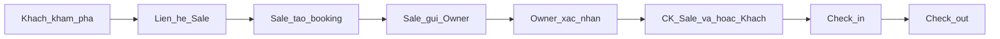

# VBNB — Tài liệu sản phẩm cho Marketing

**Tên sản phẩm:** VBNB (Sàn giao dịch tài sản lưu trú / villa marketplace)  
**Website:** https://sangiaodich-two.vercel.app  
**Ngôn ngữ giao diện:** Tiếng Việt (mặc định) và English  

Tài liệu này mô tả **vai trò người dùng, hành trình, dòng tiền và tính năng** theo đúng sản phẩm đang chạy. Dùng để brief Marketing, nội dung landing, sales deck và FAQ. Không bao gồm chi tiết kỹ thuật triển khai.

---

## 1. Giới thiệu sản phẩm

VBNB là **sàn giao dịch villa / căn hộ nghỉ dưỡng** kết nối ba bên:

| Vai trò | Họ làm gì trên VBNB |
|---|---|
| **Chủ villa (Owner)** | Đăng căn, đặt giá vốn & lịch trống, xác nhận booking, nhận tiền đúng giá gốc |
| **Sale** | Xem toàn bộ căn đang mở trên sàn + giá vốn, tạo booking hộ khách, giữ lãi |
| **Khách (Guest)** | Khám phá villa, liên hệ Sale, theo dõi booking và thanh toán qua hóa đơn QR |

**Định vị ngắn (landing):**  
*“Sàn giao dịch villa thông minh kết nối Chủ villa, Sale & Khách hàng.”*

**Ý chính:**

- Chủ villa tiếp cận mạng lưới Sale, không cần tự chạy ads cho từng khách.
- Sale không phải tự tìm căn và tự đoán lịch trống — có giá vốn và lịch real-time.
- Khách được Sale hỗ trợ chốt và phục vụ; **không tự book trên sàn** và **không thấy giá vốn / lãi Sale trên listing công khai**.

---

## 2. Ba vai trò chính

### 2.1. Chủ villa (Owner)

**Mục tiêu:** Đưa căn lên sàn, lấp phòng, nhận đủ tiền giá gốc, ít vận hành hơn.

**Họ có thể:**

- Đăng / sửa listing (villa hoặc căn hộ): ảnh, tiện ích, số phòng, vị trí.
- Đặt **giá vốn** ngày thường / cuối tuần; chỉnh lịch trống, đóng đêm.
- Nhận booking từ Sale → **xác nhận** (khóa lịch) hoặc **từ chối**.
- Theo dõi **quyết toán**: Sale đã chuyển khoản, khách đã chuyển lúc check-in, còn thiếu.
- Check-in / check-out; đánh giá Sale sau kỳ nghỉ.
- Cấu hình **STK / QR nhận tiền**; mua **gói subscription** để duy trì listing trên sàn.
- (Tuỳ chọn) Đặt **chiết khấu membership theo từng căn** cho Sale trung thành.

**Thông điệp gợi ý:**  
*“Hiển thị nhiều hơn. Booking nhiều hơn. Ít nỗ lực hơn.”*

### 2.2. Sale

**Mục tiêu:** Chốt nhanh, biết cost trước khi báo giá, tối ưu lãi và hạng theo căn.

**Họ có thể:**

- Duyệt **sàn** (toàn bộ căn ACTIVE): giá vốn, lịch trống, chiết khấu.
- **Tạo booking hộ khách** (chọn căn, ngày, khách, giá bán).
- Quản lý pipeline booking: giữ chỗ → gửi Owner → đã xác nhận → check-in → check-out.
- Nhận **lead** khi khách bấm liên hệ Sale trên listing; CRM khách đã chốt / đang follow / đã hủy.
- Theo dõi **doanh thu thực / dự kiến**, lãi từng booking.
- Cấu hình STK nhận tiền từ khách; mua **gói subscription** để mở sàn, lead và tạo booking.

**Công thức lãi (cách nói với Sale):**  
**Lãi Sale = Giá bán − Giá gốc (cost sau chiết khấu).**

**Thông điệp gợi ý:**  
*“Thông tin real-time. Cơ hội nhiều hơn.”*

### 2.3. Khách (Guest)

**Mục tiêu:** Tìm villa đẹp, được Sale hỗ trợ, thanh toán rõ ràng, theo dõi booking.

**Họ có thể:**

- Khám phá listing công khai (lọc địa điểm, tiện ích, sức chứa…); **không hiện giá trên sàn**.
- Đăng ký / đăng nhập và bấm **liên hệ Sale** → tạo lead, chia sẻ SĐT với Sale đang active.
- Xem booking Sale đã tạo: trạng thái, số đã trả, phần còn lại, liên hệ Sale.
- Thanh toán qua **link hóa đơn** (QR / chuyển khoản + nội dung CK).
- Tích lũy **hạng thành viên** theo số booking và tổng chi tiêu (GMV).

**Lưu ý quan trọng cho Marketing:** Khách **không tự đặt phòng trên sàn**. Mọi booking do Sale tạo hộ.

---

## 3. Hành trình end-to-end

### Các bước (ngắn)

1. **Chủ villa** đăng căn, set giá vốn & lịch → Admin duyệt → căn lên **sàn**.
2. **Khách** khám phá → bấm liên hệ Sale → **lead** hiện cho Sale đang có gói.
3. **Sale** báo giá, tạo booking (giá bán do Sale quyết định, không thấp hơn logic sàn).
4. Sale **gửi Owner** (booking chờ xác nhận; lịch chưa khóa cứng cho đến khi Owner confirm — nhiều Sale có thể chờ cùng ngày; booking Owner xác nhận trước thắng).
5. **Owner xác nhận** → khóa lịch. Từ chối → hoàn tiền cọc khách (theo quy tắc sản phẩm).
6. Thanh toán theo case A hoặc B (mục 4).
7. **Check-in** khi đã đủ nghĩa vụ tiền với Owner → **check-out** → (tuỳ chọn) Owner đánh giá Sale.

---

## 4. Dòng tiền (điểm bán & FAQ)

**Nguyên tắc vàng:**  
**Chủ nhà chỉ nhận đủ giá gốc (cost).** Phần chênh giá bán là **lãi của Sale**, không cộng vào túi Owner.

### Case A — Khách cọc (phổ biến)

Ví dụ:

| Khoản | Số tiền |
|---|---|
| Giá gốc (Owner) | 4.000.000 |
| Giá bán (Sale) | 5.000.000 |
| Lãi Sale | 1.000.000 |
| Khách cọc cho Sale | 2.500.000 |
| Sale chuyển Owner để chốt | **1.500.000** (= 2.500.000 − 1.000.000) |
| Khách chuyển Owner lúc check-in | **2.500.000** |
| **Owner nhận tổng** | **4.000.000** (= giá gốc) |

### Case B — Khách trả đủ cho Sale

- Khách chuyển hết giá bán cho Sale.
- Sale chuyển **toàn bộ giá gốc** cho Owner.
- Trước check-in đã **đủ CK**; khách chỉ cần nhận phòng (không còn phần Owner nếu đã đủ cost).

### Cách gọi cột trên UI (dùng thống nhất trong copy)

| Thuật ngữ | Ý nghĩa |
|---|---|
| Giá bán | Giá Sale báo khách |
| Giá gốc / Giá vốn | Cost Owner nhận |
| Lãi Sale | Giá bán − giá gốc |
| Khách CK Sale | Tiền khách đã chuyển Sale |
| Sale CK Owner | Tiền Sale đã chuyển Owner |
| Khách CK Owner | Tiền khách chuyển thẳng Owner (thường lúc check-in) |
| Đã thu / Còn thiếu | Tổng Owner đã nhận vs còn thiếu so với giá gốc |
| Đã cọc | Sale đã chuyển đủ phần cọc (không còn gọi “50%”) |

---

## 5. Tính năng theo module

### 5.1. Sàn (Marketplace)

- Listing đã duyệt (ACTIVE): ảnh, vị trí, loại căn, sức chứa, số phòng.
- **Sale** thấy giá vốn / chiết khấu; **khách & công chúng** không thấy giá.
- Sale tạo booking trực tiếp từ chi tiết căn hoặc từ lịch.

### 5.2. Lịch (Calendar / Night board)

- Xem nhiều căn theo đêm: trống / đang chờ Owner / đã khóa.
- Owner chỉnh đóng đêm, cost theo đêm.
- Sale giữ chỗ / thao tác booking trên lịch.

### 5.3. Booking & Quyết toán

- **Sale:** pipeline trạng thái, theo dõi CK khách ↔ Sale ↔ Owner.
- **Owner:** danh sách chờ xác nhận + bảng quyết toán (giá gốc, đã thu, còn thiếu, trạng thái).
- Check-in / check-out do Owner xác nhận trên sản phẩm.

### 5.4. Lead & Khách hàng (Sale CRM)

- **Lead:** khi khách xin liên hệ Sale — mọi Sale đang active đều thấy (không “claim” độc quyền trong sản phẩm hiện tại).
- **Khách đã chốt / đã lưu / đã hủy:** theo dõi SĐT, kênh (Zalo/Facebook/điện thoại), mức quan tâm, follow-up.

### 5.5. Subscription (phí vào sàn)

- Owner và Sale mua gói theo kỳ (1 / 3 / 6 / 12 tháng; ưu đãi gói dài hơn).
- **Sale không active:** không xem cost / tạo booking trên sàn, không nhận lead mới, hạn chế CRM.
- **Owner:** gói để duy trì listing trên sàn (theo mô tả sản phẩm).
- Thanh toán chuyển khoản; hệ thống khớp mã CK để kích hoạt / gia hạn.

### 5.6. Membership Sale theo căn

- Owner đặt mốc số lần check-out và % giảm **cost trên từng căn**.
- Sale làm nhiều trên căn đó → cost thấp hơn → lãi cao hơn (nếu Owner đã mở rule).
- Căn không có rule → mặc định giảm 0%.

### 5.7. Hạng khách (Guest membership)

- Tiến hạng theo **số booking** và **tổng chi tiêu (GMV)** — cần đủ cả hai ngưỡng.
- Booking xác nhận tăng tiến độ; hủy có thể làm giảm hạng.

### 5.8. Admin (vận hành nội bộ — không đẩy ra ads khách)

- Duyệt / từ chối / tạm ngưng listing.
- Quản lý user, gói subscription, STK nhận phí sàn.
- Đối soát thanh toán subscription; cấu hình ngưỡng hạng khách.

---

## 6. Chế độ Đơn giản vs Nâng cao

Người dùng Owner / Sale có thể chuyển **Đơn giản** ↔ **Nâng cao** trên header.

| | **Đơn giản** | **Nâng cao** |
|---|---|---|
| Mục đích | Thao tác nhanh, ít màn hình | Đối soát tiền & pipeline đầy đủ |
| Sale | Ưu tiên Trang chủ, Lịch, chỗ đang giữ, Hạng; tạo/gửi booking nhẹ hơn về nhập tiền | Sàn, Booking, Khách hàng, Lead, Cài đặt; theo dõi CK / margin / invoice |
| Owner | Tổng quan, Lịch, Căn, Chờ, Phí sàn; ít bước STK trên UI | Có Quyết toán, hồ sơ STK, đối chiếu ngân hàng khi confirm |

**Lưu ý nội bộ:** Chế độ Đơn giản **không bỏ** quy tắc “Owner chỉ nhận giá gốc” hay nghĩa vụ tiền trước check-in — chỉ đơn giản hóa giao diện và bước nhập liệu.

---

## 7. Thanh toán khách / người dùng thấy

- **Hóa đơn Guest:** link có mã; chọn cọc / trả đủ / phần còn lại cho Owner; **VietQR động** hoặc QR tĩnh; số tiền + **nội dung CK** bắt buộc.
- **Subscription Owner/Sale:** chuyển khoản đúng số tiền + mã CK; hệ thống tự kích hoạt khi khớp; có cổng thanh toán một lần (khi được bật).
- Marketing nên nhấn: **minh bạch số tiền và nội dung chuyển khoản**, tránh mơ hồ “thanh toán online thẻ quốc tế” nếu chưa phải focus sản phẩm.

---

## 8. Từ khóa & cụm copy sẵn dùng

Dùng thống nhất trong brochure / ads / script:

- Sàn giao dịch villa / Sàn villa  
- Giá vốn · Cost ngày thường / cuối tuần · Giá gốc · Giá sàn  
- Lãi Sale · Giá bán  
- Chỗ đang giữ · Gửi Owner · Owner xác nhận mới khóa lịch  
- Chờ xác nhận · Quyết toán · Đối chiếu STK / mã CK  
- Khách CK Sale · Sale CK Owner · Khách CK Owner lúc check-in  
- Đã cọc · Đã đủ CK · Còn thiếu · Đã thu  
- Chiết khấu Sale theo căn · Check-out càng nhiều, cost càng thấp (nếu Owner mở)  
- Thông tin real-time · Hiển thị nhiều hơn. Booking nhiều hơn. Ít nỗ lực hơn.  
- Guest không thấy giá trên sàn  

---

## 9. Phạm vi — không claim vượt sản phẩm

**Được nói:**

- Ba bên Owner / Sale / Guest trên một sàn.
- Sale tạo booking hộ; khách liên hệ Sale từ listing.
- Owner nhận đúng giá gốc; Sale giữ phần chênh.
- Lịch & giá vốn real-time cho Sale (khi có subscription).
- Hạng Sale theo căn; hạng Guest theo book + GMV.
- VI + EN.

**Không nói / không hứa (trừ khi product xác nhận sau):**

- Khách tự book & thanh toán full trên sàn như OTA cổ điển.
- Sale “độc quyền claim” lead.
- Owner luôn nhận 50% trước (đã đổi thành logic cọc / đủ theo mục 4).
- Ứng dụng native mobile riêng (hiện là web app responsive).
- Chi tiết đối tác thanh toán nội bộ trên vật liệu khách hàng cuối (trừ khi Legal/Product duyệt).

---

## 10. FAQ nhanh cho Marketing

**Q: Khách thấy giá trên sàn không?**  
A: Không. Giá do Sale báo khi liên hệ / tạo booking.

**Q: Owner có bị “cắt” thêm ngoài giá gốc không?**  
A: Không theo thiết kế sản phẩm — Owner chỉ nhận đủ giá gốc; chênh là lãi Sale.

**Q: Sale lấy lãi ở đâu?**  
A: Từ giá bán cao hơn giá gốc. Ví dụ bán 5tr, gốc 4tr → lãi 1tr.

**Q: Ai khóa lịch?**  
A: Owner khi **xác nhận** booking. Trước đó chỉ là chờ xác nhận / giữ chỗ.

**Q: Sale không trả phí có dùng sàn không?**  
A: Không đầy đủ — cần subscription active để xem cost, tạo booking, nhận lead.

**Q: App có tiếng Anh không?**  
A: Có. Mặc định tiếng Việt; chuyển sang English trên giao diện.

---

*Cập nhật theo hành vi sản phẩm hiện tại trên https://sangiaodich-two.vercel.app. Khi Marketing cần deck slide / one-pager rút gọn, dùng mục 1–4 + mục 8 làm xương sống.*
